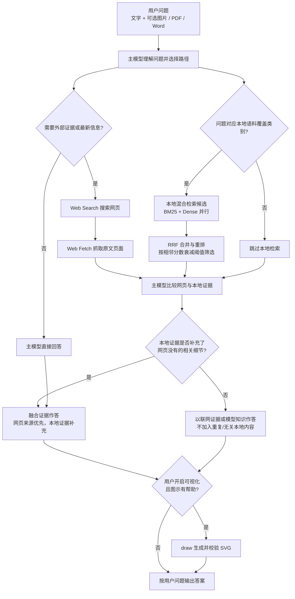

# QAagent — 柑橘与农业问答智能体

QAagent 以柑橘与农业问题为优先，支持联网查证、本地语料补充、多模态输入和按需可视化。主模型根据用户问题决定是否检索；联网证据优先组织，本地语料只在主题匹配且能补充细节时进入回答。

> 本仓库发布系统代码与构建脚本，不包含知识库全文、团队数据、模型权重或 API 凭据。运行时需要自行准备获准使用的本地语料，并在本机配置模型服务。

## 问答与证据流程



### 本地语料如何补充联网回答

主模型先判断问题所需事实是否落在当前语料范围内。文献检索可按病理病害、基因组学与进化、育种与生物技术、生理代谢、栽培生态、营养与采后等类别查询；另有 UCR 柑橘品种记录、《中国柑橘品种》数字化记录和 CGI 实验方法。超出这些类别的新闻、时效性政策或其他无对应语料的问题，不会为了“融合”而盲查本地库。

对适合联网的问题，Web Search / Web Fetch 提供外部证据；当本地类别匹配时，混合检索可并行提供候选。中文问题会先转为英文再进入本地 BM25 和 Dense，翻译失败或仍含中文则停止本地检索，不以中文查询回退。BM25 与 Dense 结果经 RRF 合并、重排和阈值过滤；主模型只纳入与问题相关、去重且能补充网页或解决证据缺口的片段。文献通常可用 DOI 回溯，品种和实验方法记录可能没有 DOI。

联网结果与本地记录都会提供来源线索。最终回答优先给出网页原文链接；使用本地片段时标明其本地来源，不把无关命中或重复摘要塞入答案。用户明确限定信息来源时，主模型按用户要求执行。

## 多模态输入与可视化

- 可上传或拖入 JPG、PNG、WebP、GIF 图片，以及 PDF、DOCX 文件；每轮最多 8 个附件、总计 20 MB。
- 图片作为本轮视觉输入交给配置的主模型；PDF / DOCX 会提取文本，扫描版 PDF 可将少量页面作为图像输入。附件仅用于当前请求，不写入共享知识库或会话原文历史。
- 用户可开启“可视化”。主模型认为图示有帮助时可调用 `draw` 生成经校验的 SVG；简单问题不会被强制配图。

## 病害图像初筛（可选模块）

用户上传柑橘叶片或果实照片并询问「这是什么病」时，主模型可以调用 `disease_diagnose` 做一次图像初筛，再结合症状描述、知识库与联网证据作答。

- **覆盖**：10 类柑橘（溃疡病、黄龙病、黑斑病、黑点病、煤烟病、叶片枯焦、叶卷曲病毒、红蜘蛛、细菌性疫病、健康）+ 1 个弱参考标签（白粉病）；另有 16 类明确声明「不在范围内」。范围外一律拒答，报告固定附覆盖范围与「不是诊断结论、需专家复核」。
- **预处理不居中裁剪**：EXIF 校正 → 长边限 1600 → HSV 叶片前景检测 → letterbox 等比补边；大图再切 2×2 重叠子图，按视图取最高分，避免病斑被切掉或缩到看不见。
- **模型**：三个公开预训练权重导出 ONNX（ConvNeXt-Small / ViT-B/16 / PlantVillage MobileNetV2），CPU 可跑，DirectML 加速下三模型约 90–140 ms。
- **模型文件不进仓库**：首次运行 `python 04_脚本_scripts/prepare_models.py --vision`，从 GitHub Release 下载到 `agent/models/vision`。
- **许可**：`unknown` / `other` 的权重默认不加载，需要黑点病、黄龙病与白粉病弱标签时在 `config.yaml` 打开 `vision.allow_unlicensed_models: true`。
- **状态**：`GET /api/v2/vision/status` 报告模型文件、许可、实际 ONNX provider 与覆盖类别。设计与实测见 [docs/vision.md](docs/vision.md)。
### 准备本地语料（可选）

把有权使用的文献放进一个目录，再按批次入库；索引产物落在 `agent/`，不随仓库分发：

```powershell
python 04_脚本_scripts\ingest.py --dir "D:\我的文献" --batch mycorpus     # 切块 + 向量化 → chunks.jsonl / qdrant_data
python 04_脚本_scripts\reindex_lance.py --batch mycorpus                # 生成 LanceDB 索引 → lancedb/mycorpus.lance
```

重排模型损坏或想强制重嵌入时加 `--no-qdrant` 整体重建。模型权重由 `prepare_models.py` 下载（默认走
`HF_ENDPOINT=https://hf-mirror.com`，缓存落在 `agent/.hf_cache/`）；只要向量模型、跳过 1–2 GB 重排模型用
`--skip-reranker`，要一并下载病害图像模型用 `--vision`。
## 代码结构

- `01_源码_src/`：API、检索、证据处理、智能体和 Web 界面。
- `02_配置_config/`：系统配置。
- `04_脚本_scripts/`：知识库准备、索引和模型准备工具。
- `01_源码_src/web/`：唯一维护的前端目录。
- `run.ps1`、`stop.ps1`：Windows 本地启动与停止脚本。
- `agent/`：本地运行数据、缓存、状态与日志，不应提交。

## 本地运行

环境要求：Windows PowerShell、Python 3.10–3.12、Git。首次启动需要联网安装依赖并下载公开模型权重；服务运行需要可用的主模型 API 凭据。凭据只应保存在本机。

```powershell
git clone <QAagent 仓库地址>
cd QAagent
```

将自行准备且有权使用的 LanceDB 知识库索引放入 `agent/data/lancedb/`，然后运行：

```powershell
powershell -ExecutionPolicy Bypass -File .\run.ps1
```

浏览器打开 `http://localhost:8000` 后配置模型 API。没有本地索引时，启动脚本会提示准备索引；本仓库不分发语料全文。

## 许可与数据边界

代码许可见 [`LICENSE`](LICENSE)。本仓库不授权使用第三方论文、数据库、模型或数据集；请在取得相应许可后下载、处理或分发这些材料。请勿提交 API 密钥、用户数据或未获分发许可的全文文献。

病害图像初筛使用的三个权重来自公开模型仓库，许可分别为 Apache-2.0、未标注、other（详见 [docs/vision.md](docs/vision.md)）；权重不随仓库分发，`unknown`/`other` 的模型默认不加载。